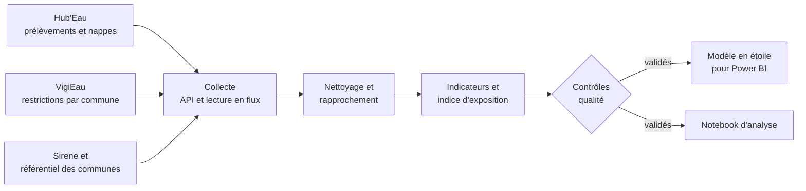
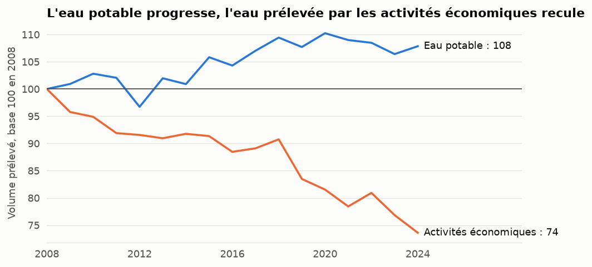
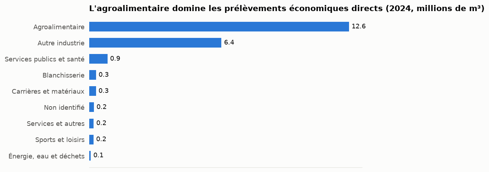
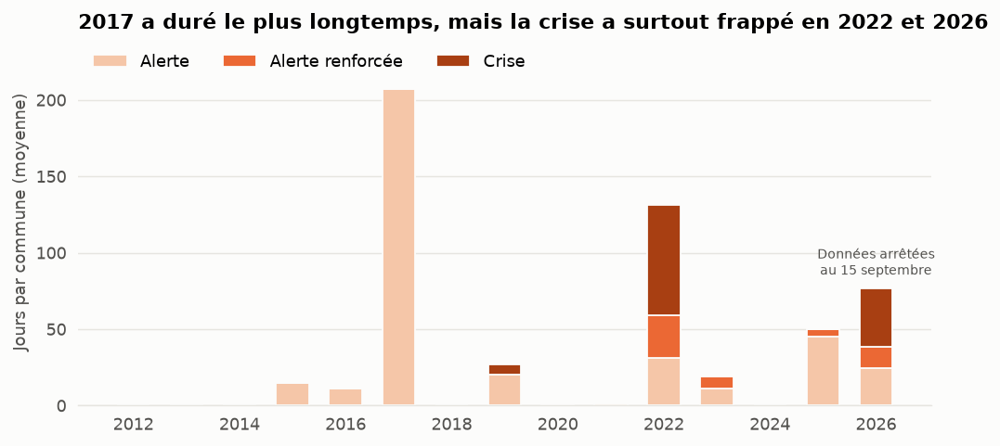
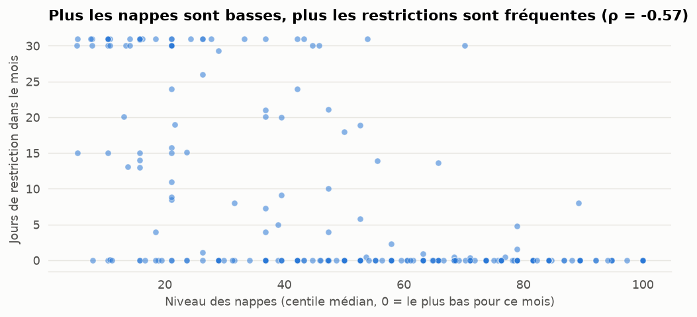
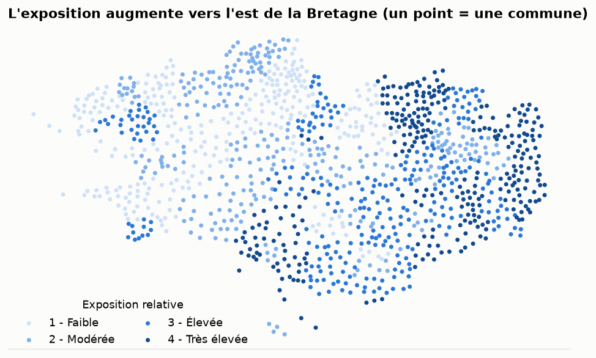

# Eau et activités économiques en Bretagne

**Quels territoires bretons sont les plus exposés à la sécheresse, et qu'est-ce que cela change pour les entreprises ?**

Ce projet de portfolio croise cinq sources ouvertes, de la collecte par API jusqu'à un modèle prêt pour Power BI. Il aide une PME à situer le risque eau de son territoire, même si elle ne prélève pas d'eau elle-même.

| Pour aller plus loin | |
|---|---|
| [Analyse commentée](notebooks/analyse_eau_bretagne.ipynb) | Le raisonnement, le code et les graphiques |
| [Méthodologie détaillée](docs/METHODOLOGIE.md) | Chaque choix, ses raisons et ses limites |
| [Guide Power BI](powerbi/GUIDE_POWER_BI.md) | Le modèle, les mesures DAX et le plan du rapport |

> **État du projet :** le pipeline, l'analyse et les fichiers Power BI sont terminés. Le rapport Power BI reste à assembler et à publier, et ses mesures DAX n'ont pas encore été exécutées.

## En bref

- **73 %** de l'eau prélevée en 2024 vient des eaux de surface, plus sensibles au manque de pluie.
- **72 jours de crise** en moyenne par commune en 2022, et déjà **39** en 2026 au 15 septembre.
- **8 %** seulement de l'eau prélevée par les activités économiques concerne des PME identifiées.
- **1 habitant sur 3** vit dans le quartile de communes le plus exposé.

## Pourquoi ce sujet ?

La Bretagne a une image de région humide, mais sa ressource en eau reste fragile, et l'agroalimentaire y occupe une place importante. En 2022, des arrêtés ont limité les volumes d'eau utilisés par des industriels, jusqu'à entraîner des fermetures temporaires dans le bassin de Pontivy.

La question initiale était de mesurer l'eau consommée par les PME. Les données ne le permettent pas : elles ne comptent que les prélèvements directs, alors que la plupart des PME sont raccordées au réseau public. Le projet mesure donc l'exposition des **territoires**, car une restriction concerne tous les usagers d'une commune.

## La méthode



1. **Collecter.** Les API sont interrogées avec reprise sur erreur. L'historique national VigiEau (11,9 Go décompressés) est lu en flux : seules les communes bretonnes sont conservées.
2. **Nettoyer.** L'eau turbinée par les barrages est exclue, car elle retourne au cours d'eau. Les doublons sont retirés et les communes fusionnées sont rattachées à leur commune actuelle.
3. **Rapprocher.** Les noms libres des ouvrages sont reliés à Sirene pour obtenir secteur et taille. La règle exige un mot distinctif commun et un établissement dans la même commune, ce qui évite les homonymes.
4. **Mesurer.** Les jours de restriction sont pondérés par leur gravité, les nappes sont comparées à leur propre historique et les évolutions sont calculées à périmètre constant.
5. **Synthétiser.** Un indice classe les 1 202 communes, puis un test de sensibilité mesure l'effet des pondérations.
6. **Contrôler.** Les tables ne sont pas publiées si un contrôle échoue, par exemple si les volumes ne correspondent plus à la source.

## Les résultats

### L'eau potable progresse, l'eau économique recule



En 2024, 276 millions de m³ ont été prélevés hors barrages : 91 % pour l'eau potable, 8 % pour les activités économiques et 2 % pour l'irrigation. Depuis 2008, l'eau potable augmente de 8 % et l'eau prélevée par les activités économiques baisse de 26 %.

Cette baisse ne prouve pas à elle seule une sobriété. Elle peut aussi venir de fermetures ou d'un passage au réseau public.

### Les prélèvements directs viennent surtout de l'agroalimentaire et des grands groupes



L'agroalimentaire représente 59 % de l'eau économique. Les ETI et les grandes entreprises en prélèvent 83 %, contre 8 % pour les PME identifiées. Le reste n'a pas pu être classé. Ce constat confirme que la plupart des PME ne sont pas visibles dans ces données.

### Le total de 2022 était trompeur

Le total monte en 2022, alors que des usines ont dû réduire leur consommation. Cette hausse vient de 5 ouvrages qui entrent dans la base pour 1,8 million de m³, sans prédécesseur identifiable. Cela ressemble à un enregistrement groupé de sites existants, une hypothèse qui reste à confirmer.

| Année | Périmètre constant (130 ouvrages) | Évolution | Total publié |
|---|---|---|---|
| 2021 | 22,5 Mm³ | référence | 22,7 Mm³ |
| 2022 | 21,6 Mm³ | −4,3 % | 23,4 Mm³ |
| 2023 | 20,3 Mm³ | −9,9 % | 22,3 Mm³ |

### Compter les jours ne suffit pas



2017 a duré le plus longtemps, avec 207 jours d'alerte en moyenne par commune, mais sans aucun jour de crise. 2022 a été plus courte et bien plus grave, avec 72 jours de crise. 2026 en compte déjà 39 au 15 septembre, ce qui la place deuxième sur ce critère. Deux crises majeures en cinq ans ne suffisent toutefois pas à établir une tendance climatique.

### Les restrictions suivent les nappes, sans mécanisme automatique



De juin à octobre, plus les nappes sont basses, plus les restrictions sont fréquentes (corrélation de rang de −0,57 sur 300 mois-départements). À niveau égal, les décisions varient selon les départements et les années.

### L'exposition est plus forte dans l'est



| Classe | Communes | Habitants |
|---|---|---|
| 1 - Faible | 301 | 619 439 |
| 2 - Modérée | 300 | 595 233 |
| 3 - Élevée | 300 | 1 075 246 |
| 4 - Très élevée | 301 | 1 159 452 |

L'indice combine la gravité des restrictions (50 %), la pression sur la ressource (30 %) et la dépendance aux eaux de surface (20 %). Sur les 301 communes les plus exposées, 172 sont en Ille-et-Vilaine, 69 dans les Côtes-d'Armor, 60 dans le Morbihan et aucune dans le Finistère.

Ces poids sont un choix d'analyste. Selon le scénario testé, 19 à 30 % des communes du quartile le plus exposé changent. L'indice sert donc à repérer de grandes zones, pas à départager deux communes voisines.

## Ce que cela signifie pour une PME

1. **Ne pas prélever d'eau ne protège pas.** Une restriction peut concerner une entreprise raccordée au réseau, selon les mesures de l'arrêté.
2. **Le risque se lit à l'échelle locale.** Il dépend du territoire, de sa ressource et de ses restrictions passées.
3. **La prochaine étape est interne.** Seules les factures d'eau d'une entreprise permettent de mesurer sa propre dépendance.

## Principales limites

- La consommation réelle des entreprises raccordées au réseau n'est pas mesurée.
- L'indicateur montre où l'eau est prélevée, pas d'où vient l'eau consommée : Rennes Métropole n'affiche ainsi que 5 % d'eau de surface.
- 78 % des écarts de gravité s'expliquent par le département, ce qui reflète aussi des pratiques préfectorales. Dans les Côtes-d'Armor et le Finistère, toutes les communes ont le même nombre de jours de restriction sur 2016-2025.
- Les secteurs reposent en partie sur des corrections manuelles, non vérifiées site par site.
- Seules les publications officielles des préfectures font foi.

La [méthodologie](docs/METHODOLOGIE.md) détaille toutes les limites.

## Compétences démontrées

| Domaine | Mise en œuvre |
|---|---|
| Collecte | API paginées, reprise sur erreur, lecture en flux d'un fichier de 11,9 Go |
| Qualité | Contrôles bloquants, 25 tests unitaires, réconciliation des volumes |
| Rapprochement | Noms libres reliés à Sirene avec une règle anti-homonymes |
| Analyse | Périmètre constant, corrélation de rang, indice composite, test de sensibilité |
| Modélisation | Modèle en étoile, mesures DAX, plan de rapport |
| Éthique | Aucun volume associé à un nom d'entreprise, seuil de 3 ouvrages pour les secteurs |

## Reproduire

```bash
python3 -m venv .venv
```

```bash
.venv/bin/pip install -r requirements.lock.txt -e .
```

```bash
.venv/bin/python -m eau_bretagne tout
```

```bash
.venv/bin/python -m pytest
```

La commande `tout` lit environ 586 Mo depuis VigiEau et interroge plusieurs API publiques. Elle est nécessaire pour réexécuter le notebook, car les données brutes et les tables nommées ne sont pas dans ce dépôt. Les sources évoluant, les résultats peuvent différer de ceux présentés ici, collectés le 5 novembre 2026.

## Structure

```text
src/eau_bretagne/   Collecte, rapprochement, transformations, contrôles, assemblage
tests/              Tests unitaires
notebooks/          Analyse commentée
data/processed/     Tables agrégées
data/reference/     Tables de corrections documentées
powerbi/            Données exportées, mesures DAX, thème, guide
docs/               Méthodologie et graphiques
```

## Sources

| Source | Producteur | Licence |
|---|---|---|
| [Prélèvements en eau](https://www.data.gouv.fr/dataservices/hubeau-prelevements-en-eau) | Hub'Eau, BNPE | À vérifier sur la fiche de la source |
| [Piézométrie](https://www.data.gouv.fr/dataservices/hubeau-piezometrie) | Hub'Eau, ADES | À vérifier sur la fiche de la source |
| [Donnée Sécheresse VigiEau](https://www.data.gouv.fr/datasets/donnee-secheresse-vigieau) | Ministère de la Transition écologique | Licence Ouverte 2.0 |
| [API Recherche d'entreprises](https://recherche-entreprises.api.gouv.fr) | DINUM, Insee | À vérifier sur la fiche de la source |
| [API Découpage administratif](https://geo.api.gouv.fr) | DINUM | À vérifier sur la fiche de la source |

Le contexte de 2022 s'appuie sur [Le Journal des Entreprises](https://www.lejournaldesentreprises.com/article/comment-les-entreprises-bretonnes-sadaptent-au-manque-deau-2047348) et [Réussir](https://www.reussir.fr/articles/secheresse-comment-les-usines-agroalimentaires-bretonnes-gerent-la-penurie-deau).

## Licence

Le code de ce dépôt est sous [licence MIT](LICENSE). Les données restent soumises aux licences de leurs producteurs, listées ci-dessus.
